# Spring-PDF

Demo các thao tác xử lý PDF trên Spring Boot 4 / Java 25, dùng hai thư viện:

| Thư viện | Phiên bản | Dùng cho |
|---|---|---|
| **OpenPDF** (`com.github.librepdf:openpdf`) | 3.0.0 | Sinh PDF đơn giản theo mô hình `Document` / `Paragraph` (`/demo/invoice`, `/demo/pdf`) |
| **Apache PDFBox** (`org.apache.pdfbox:pdfbox`) | 3.0.8 | Vẽ PDF cấp thấp, trích text, tách/gộp, form, render ảnh, in, ký số |

Ngoài phần PDF, project còn có một cơ chế **Strategy Executor** tự đăng ký bean theo kiểu generic (`POST /demo/{type}`).

> **Trạng thái:** project đang dang dở. Phần lớn method trong `PDFServiceImpl` đang bị comment, và
> `IPDFService` mới khai báo `createPDF()` / `createImagePDF()`. Xem mục [Trạng thái hiện tại](#trạng-thái-hiện-tại)
> trước khi build.

---

## 1. Kiến trúc tổng quan

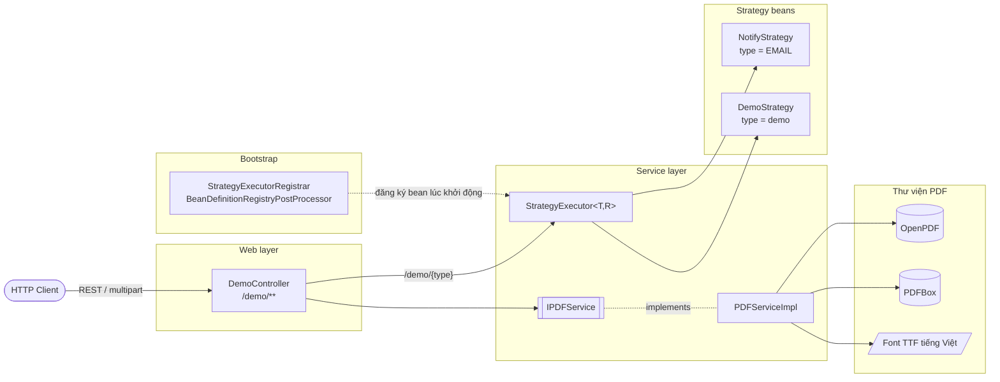

### Cấu trúc package

```
org.example.springpdf
├── SpringPdfApplication.java          # main
├── StrategyExecutorAutoConfig.java    # (đã comment) cấu hình cũ, thay bằng AutoConfiguration
├── controller/
│   └── DemoController.java            # toàn bộ endpoint /demo/**
├── service/
│   ├── IPDFService.java               # interface nghiệp vụ PDF
│   ├── PDFServiceImpl.java            # cài đặt bằng OpenPDF + PDFBox
│   ├── Strategy.java                  # Strategy<T, R> { type(); execute(T) }
│   └── StrategyExecutor.java          # map type -> Strategy, dispatch theo type
├── handler/
│   ├── NotifyStrategy.java            # Strategy<NotifyRequest, NotifyResult>
│   └── DemoStrategy.java              # Strategy<Void, Void>
├── model/
│   ├── NotifyRequest.java
│   └── NotifyResult.java
└── registrar/
    └── StrategyExecutorRegistrar.java # tự sinh bean StrategyExecutor theo cặp generic

resources/META-INF/spring/
└── org.springframework.boot.autoconfigure.AutoConfiguration.imports  # đăng ký Registrar
```

### Nguyên tắc thiết kế

- **Controller mỏng:** chỉ đọc `MultipartFile` → `byte[]`, gọi service, rồi bọc kết quả bằng helper
  `file(body, filename, mediaType)` (đặt `Content-Type` + `Content-Disposition: attachment` với tên file UTF-8).
- **Service thuần `byte[]`:** mọi method nhận/trả `byte[]`, không phụ thuộc Servlet API → dễ unit test,
  dễ tái sử dụng (queue, batch...).
- **Xử lý in-memory:** PDF được load bằng `Loader.loadPDF(byte[])` và ghi ra `ByteArrayOutputStream`
  (helper `save(doc)`). Kết quả nhiều file (split, render all) được đóng gói ZIP (helper `zip(...)`).
  Ngoại lệ: `/demo/invoice` stream thẳng vào `HttpServletResponse`, `preflight` cần file tạm.
- **Tọa độ:** PDF dùng gốc **dưới-trái**; các API nhận vùng/vị trí từ UI (`/text/area`, `/sign`) dùng gốc
  **trên-trái**, đơn vị point (1pt = 1/72 inch).
- **Font tiếng Việt:** font chuẩn của PDF (Helvetica...) không có dấu tiếng Việt, nên phải nhúng font TTF
  (`loadFont(doc, subset)`). `subset=true` cho tài liệu thường (file nhỏ), `subset=false` cho AcroForm
  (người dùng gõ ký tự bất kỳ).

---

## 2. Danh sách API

Base path: `/demo`

| # | Method | Path | Input | Output | Thư viện |
|---|---|---|---|---|---|
| 0 | GET | `/invoice` | – | `invoice.pdf` (stream) | OpenPDF |
| 0 | GET | `/pdf` | – | `demo.pdf` | OpenPDF |
| 1 | POST | `/create` | `customer`, part `logo` (tùy chọn) | `hoa-don.pdf` | PDFBox |
| 2 | POST | `/text` | part `file`, `startPage`, `endPage`, `sortByPosition`, `password` | JSON `TextResult` | PDFBox |
| 2 | POST | `/text/area` | part `file`, `page`, `x`, `y`, `w`, `h` | JSON `{ "text": ... }` | PDFBox |
| 3 | POST | `/split` | part `file`, `pagesPerFile` hoặc `ranges="1-2,3"` | `split.zip` | PDFBox |
| 3 | POST | `/merge` | part `files` (nhiều file, đúng thứ tự) | `merged.pdf` | PDFBox |
| 4 | POST | `/form/sample` | – | `form-mau.pdf` | PDFBox |
| 4 | POST | `/form/read` | part `file` | JSON `List<FieldInfo>` | PDFBox |
| 4 | POST | `/form/fill` | part `file`, part `values` (JSON), `flatten` | `form-da-dien.pdf` | PDFBox |
| 5 | POST | `/preflight` | part `file` | JSON `PreflightResult` | PDFBox Preflight |
| 6 | POST | `/render` | part `file`, `page`, `dpi`, `format=png\|jpg` | `page-N.png/jpg` | PDFBox |
| 6 | POST | `/render/all` | part `file`, `dpi`, `format` | `pages.zip` | PDFBox |
| 7 | GET | `/print/printers` | – | JSON `List<String>` | Java Print API |
| 7 | POST | `/print` | part `file`, `printer`, `copies` | JSON `{ "printedOn": ... }` | PDFBox + Java Print |
| 8 | POST | `/sign` | part `file`, `reason`, `location`, `visible`, `page`, `x,y,w,h`, `belowText`, part `stamp` | `signed.pdf` | PDFBox + BouncyCastle |
| 8 | POST | `/verify` | part `file` | JSON `List<SignatureCheck>` | PDFBox + BouncyCastle |
| – | POST | `/{type}` | JSON `NotifyRequest` | JSON `NotifyResult` | Strategy |

> `POST /demo/{type}` là path có biến; Spring ưu tiên path tĩnh nên `/demo/create`, `/demo/text`... không bị
> nuốt. Tuy nhiên nếu gọi nhầm một path chưa tồn tại (ví dụ `/demo/crate`) request sẽ rơi vào Strategy và
> báo `No strategy 'crate'`.

---

## 3. Sequence diagram các luồng PDF

### 3.1 Luồng chung cho các API nhận file upload

Hầu hết endpoint POST đều đi theo khuôn này:

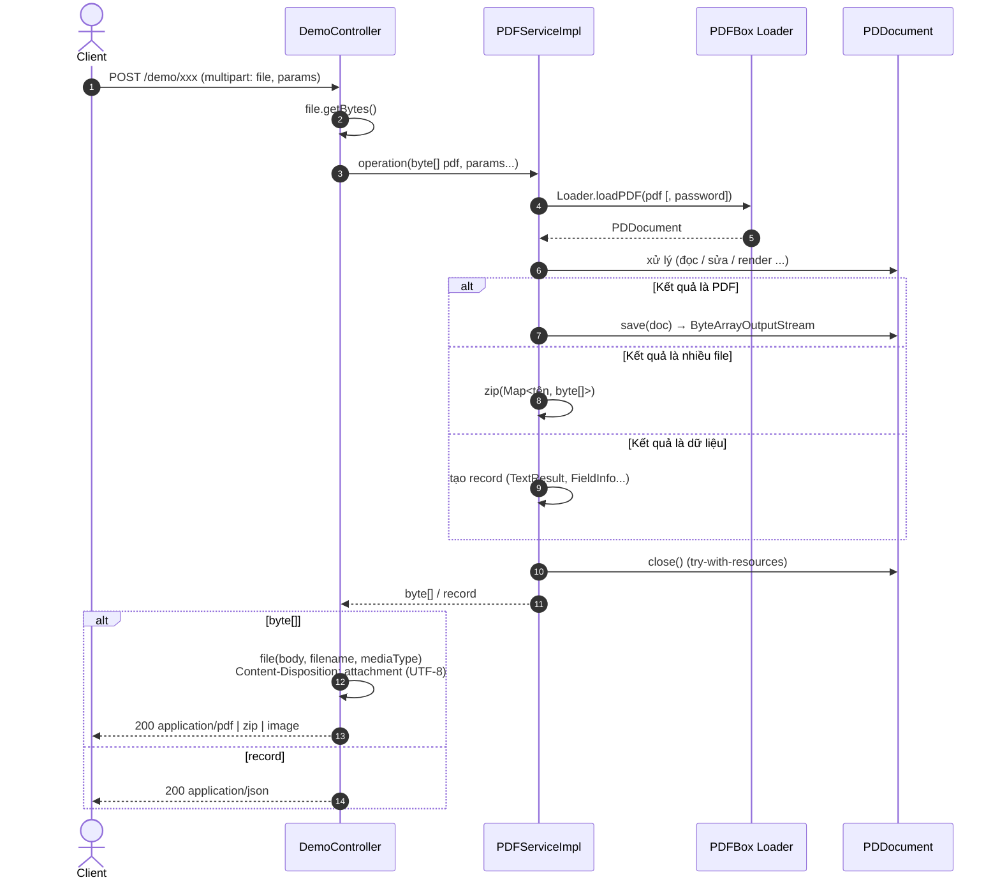

### 3.2 `GET /demo/invoice` — OpenPDF, stream trực tiếp ra response

```mermaid
sequenceDiagram
    autonumber
    actor C as Client
    participant DC as DemoController
    participant R as HttpServletResponse
    participant OP as OpenPDF Document / PdfWriter

    C->>DC: GET /demo/invoice
    DC->>R: setContentType("application/pdf")<br/>Content-Disposition: attachment; filename=invoice.pdf
    DC->>R: getOutputStream() → BufferedOutputStream
    DC->>OP: new Document()<br/>PdfWriter.getInstance(document, bos)
    DC->>OP: open()
    DC->>OP: add(Paragraph "DUYTRAN.COM")
    DC->>OP: add(Paragraph "Invoice generated at: now")
    DC->>OP: close()
    OP-->>R: ghi byte PDF vào stream
    alt DocumentException
        DC-->>C: IOException("PDF creation failed") → 500
    else OK
        R-->>C: 200 invoice.pdf (chunked, không biết trước độ dài)
    end
```

Ưu điểm: không giữ toàn bộ PDF trong heap. Nhược: lỗi xảy ra giữa chừng khi response đã commit thì client
nhận file hỏng thay vì mã lỗi.

### 3.3 `GET /demo/pdf` — OpenPDF, build trong bộ nhớ

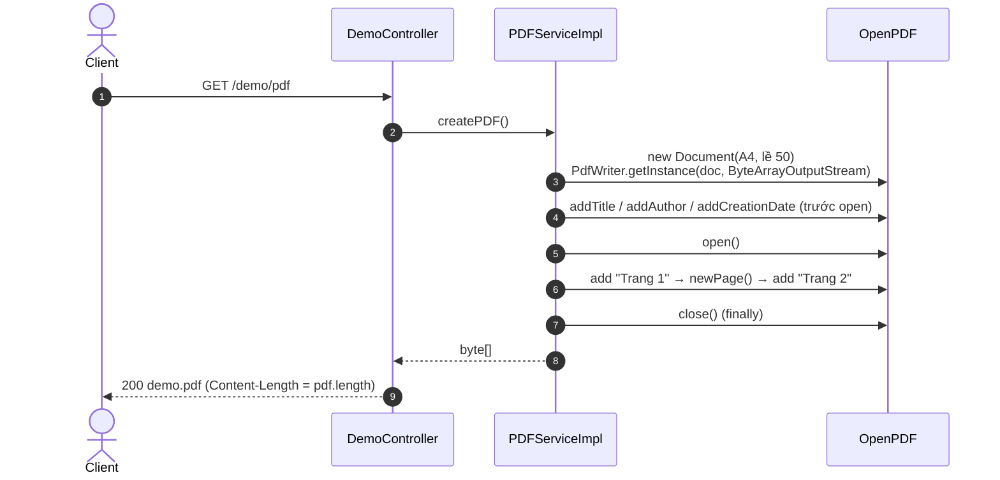

### 3.4 `POST /demo/create` — Hóa đơn bằng PDFBox (vẽ cấp thấp)

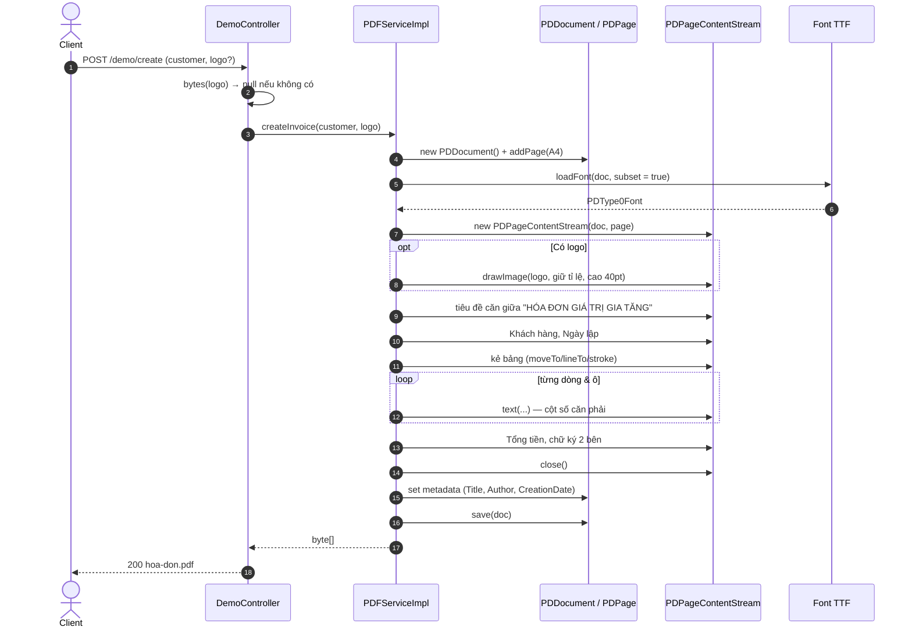

### 3.5 Trích xuất text — `/text` và `/text/area`

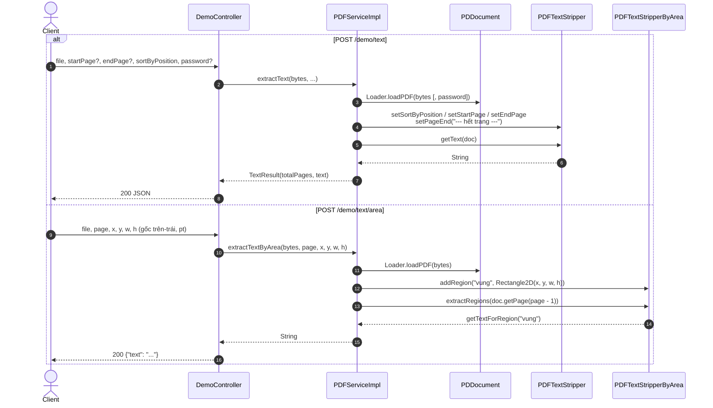

### 3.6 Tách / gộp — `/split` và `/merge`

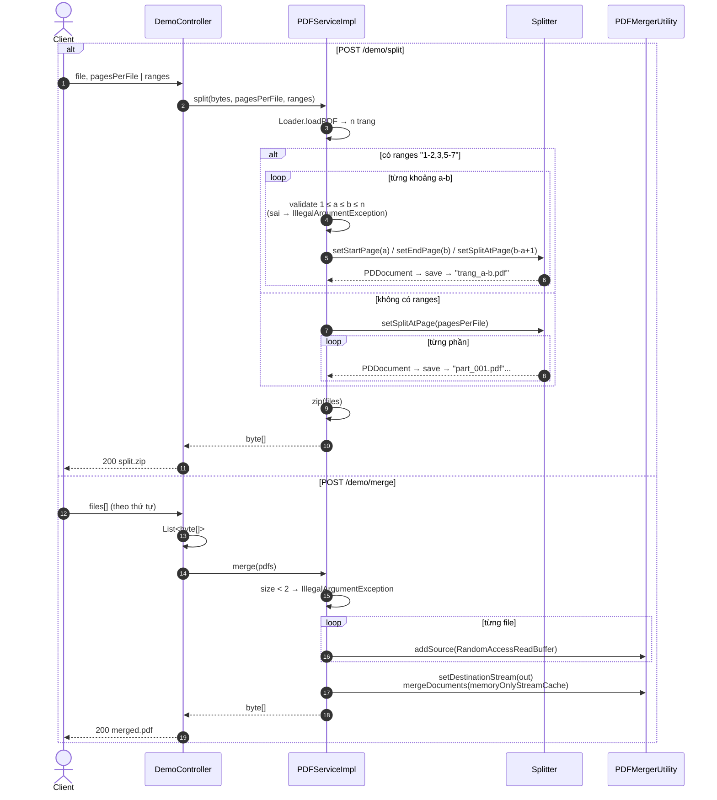

### 3.7 Form (AcroForm) — tạo mẫu, đọc, điền

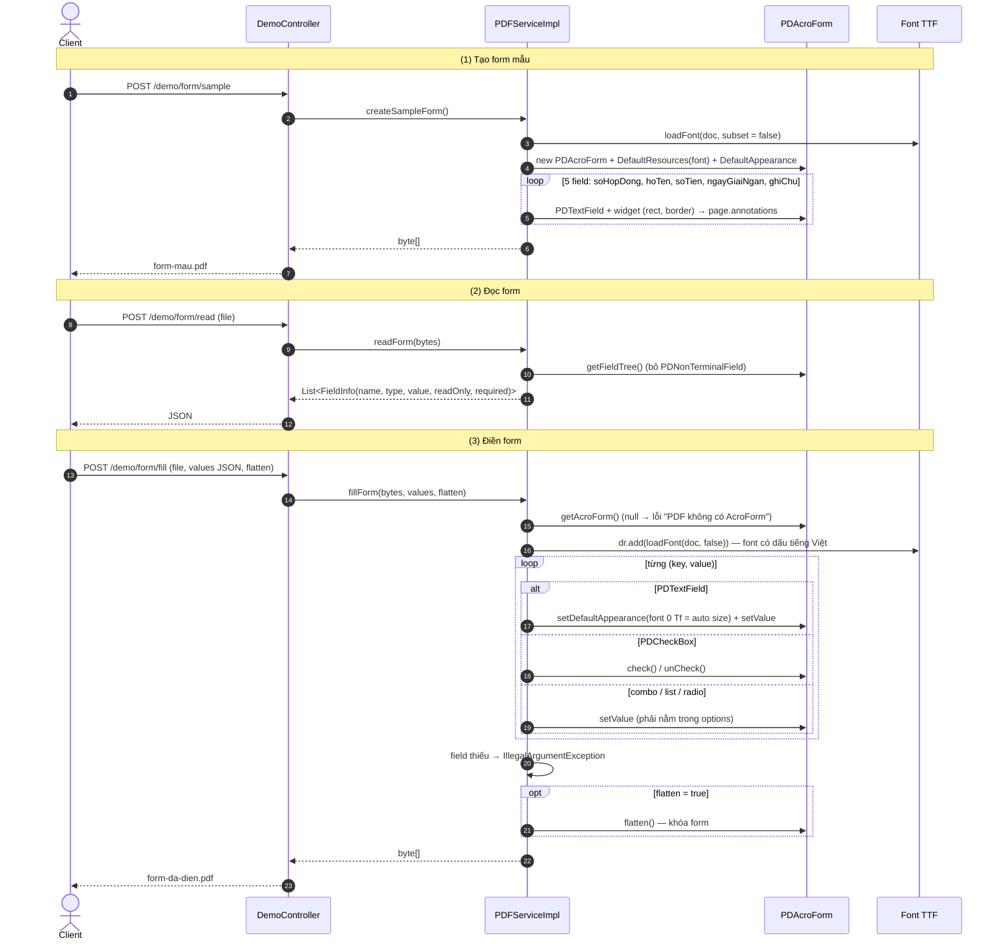

### 3.8 Preflight PDF/A-1b

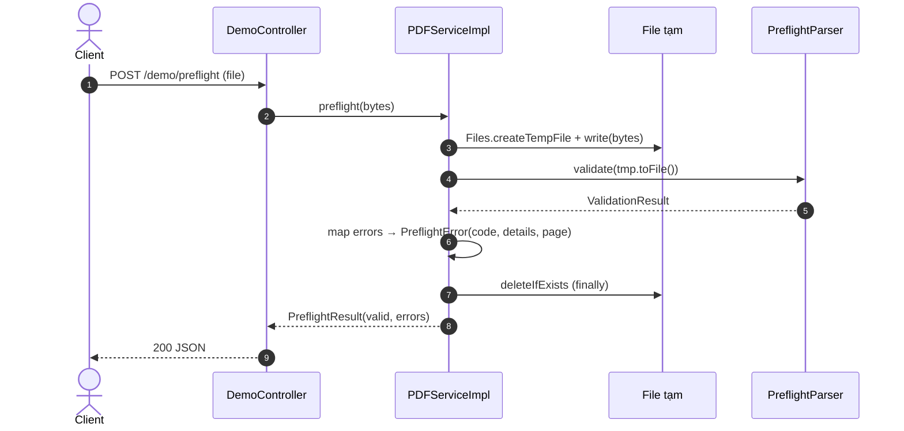

### 3.9 Render ảnh — `/render` và `/render/all`

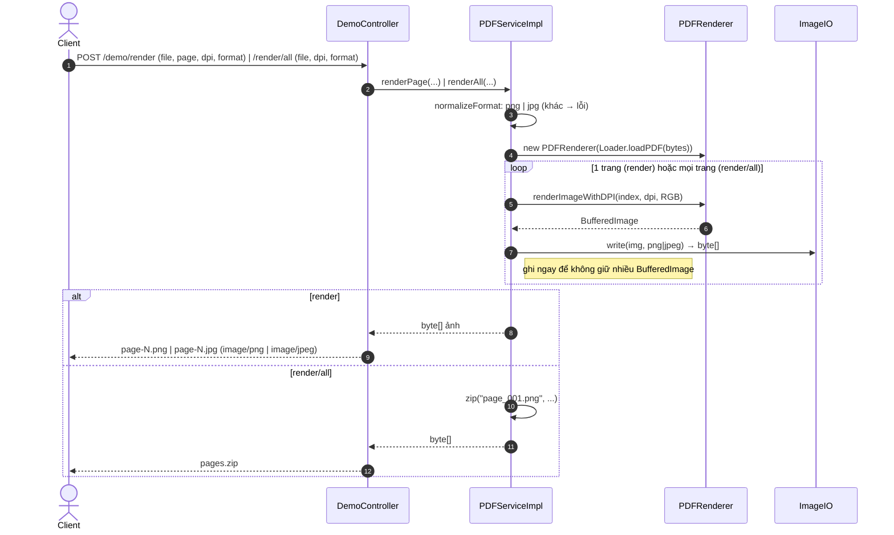

### 3.10 In — `/print/printers` và `/print`

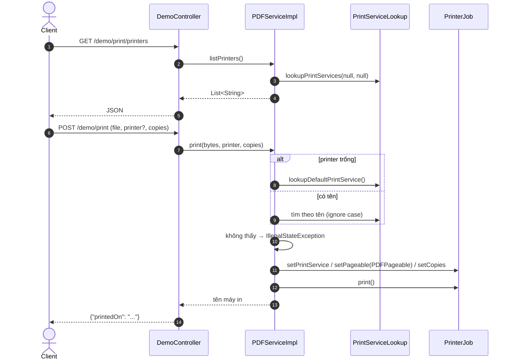

Chỉ hoạt động khi máy chủ có spooler (CUPS / Windows) — không chạy được trong container thông thường.

### 3.11 Ký số và xác thực — `/sign` và `/verify`

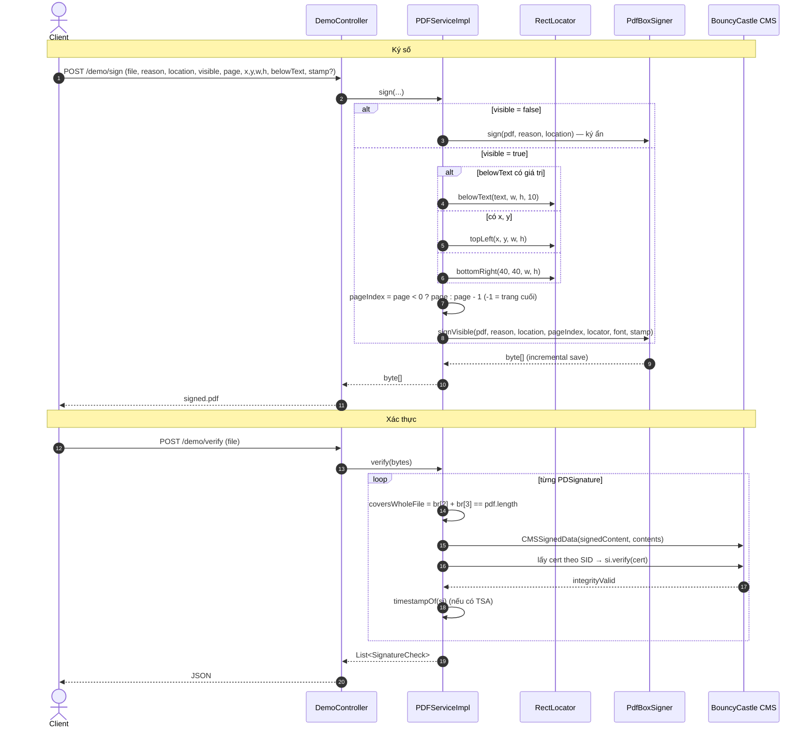

`verify` chỉ kiểm tra **toàn vẹn** (hash + chữ ký khớp nội dung) và việc chữ ký có phủ hết file hay không.
Chưa kiểm tra chuỗi tin cậy / thu hồi chứng thư (OCSP/CRL) — việc đó nên dùng EU DSS hoặc pyHanko.

---

## 4. Strategy Executor

### 4.1 Khởi động: tự đăng ký `StrategyExecutor` theo generic

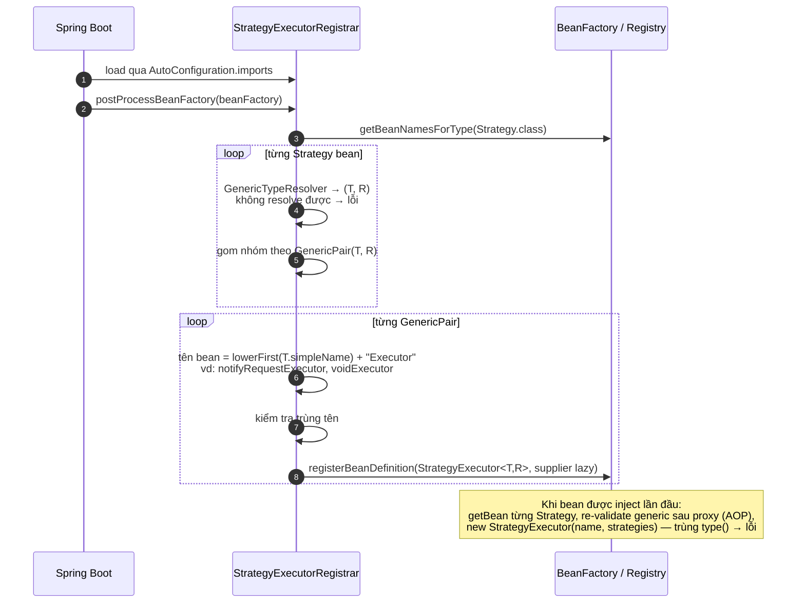

### 4.2 Runtime: `POST /demo/{type}`

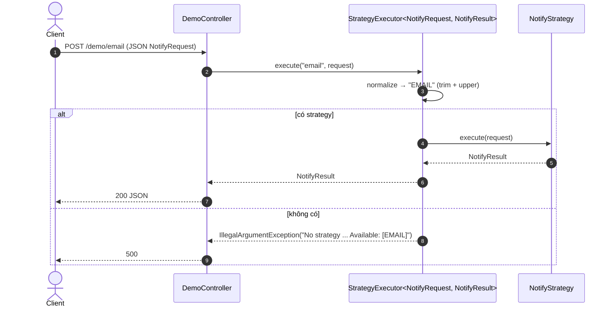

Thêm kênh mới chỉ cần tạo bean `implements Strategy<NotifyRequest, NotifyResult>` với `type()` riêng — không phải
sửa controller hay executor.

---

## 5. Build & chạy

Yêu cầu: JDK 25.

```bash
./gradlew bootRun
```

Ví dụ gọi API:

```bash
curl -o demo.pdf     http://localhost:8080/demo/pdf
curl -o hoa-don.pdf  -F customer="Công ty ABC" -F logo=@logo.png http://localhost:8080/demo/create
curl -F file=@a.pdf -F startPage=1 -F endPage=2 http://localhost:8080/demo/text
curl -o split.zip    -F file=@a.pdf -F ranges="1-2,3" http://localhost:8080/demo/split
curl -o merged.pdf   -F files=@a.pdf -F files=@b.pdf http://localhost:8080/demo/merge
curl -o filled.pdf   -F file=@form-mau.pdf \
     -F 'values={"hoTen":"Nguyễn Văn A"};type=application/json' -F flatten=true \
     http://localhost:8080/demo/form/fill
curl -o page-1.png   -F file=@a.pdf -F page=1 -F dpi=150 http://localhost:8080/demo/render
```

---

## Trạng thái hiện tại

Code đang ở giữa quá trình chuyển đổi, **chưa compile được**. Những việc cần làm để chạy đủ các luồng trên:

**`DemoController`**
- Thiếu field `StrategyExecutor<NotifyRequest, NotifyResult> strategyExecutor` (đang dùng ở `send`).
- Thiếu hằng `PDF` / `ZIP` (ví dụ `MediaType.APPLICATION_PDF` và `MediaType.parseMediaType("application/zip")`).
- Thiếu import `java.util.List`, `java.util.ArrayList` và các record `TextResult`, `FieldInfo`, `PreflightResult`,
  `SignatureCheck` (đang nằm trong `PDFServiceImpl`).

**`IPDFService` / `PDFServiceImpl`**
- Interface mới có `createPDF()` / `createImagePDF()`; cần khai báo thêm các method controller đang gọi.
- Phần lớn method (mục 2 → 8) và helper `text`, `width`, `money`, `zip`, `normalizeFormat`, `toImageBytes`
  đang bị comment.
- `fontFile()` dùng `props.fontPath()` nhưng `DemoProperties` chưa tồn tại (cần property kiểu `demo.font-path`
  trỏ tới font TTF có dấu tiếng Việt).
- `PdfBoxSigner`, `RectLocator` chưa có.

**Dependency còn thiếu trong `build.gradle.kts`**
- `org.apache.pdfbox:preflight` — cho `/preflight`.
- `org.bouncycastle:bcprov-jdk18on`, `org.bouncycastle:bcpkix-jdk18on` — cho `/sign`, `/verify`.
