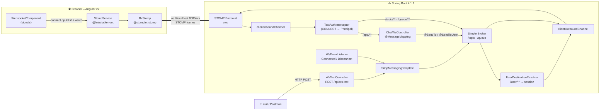
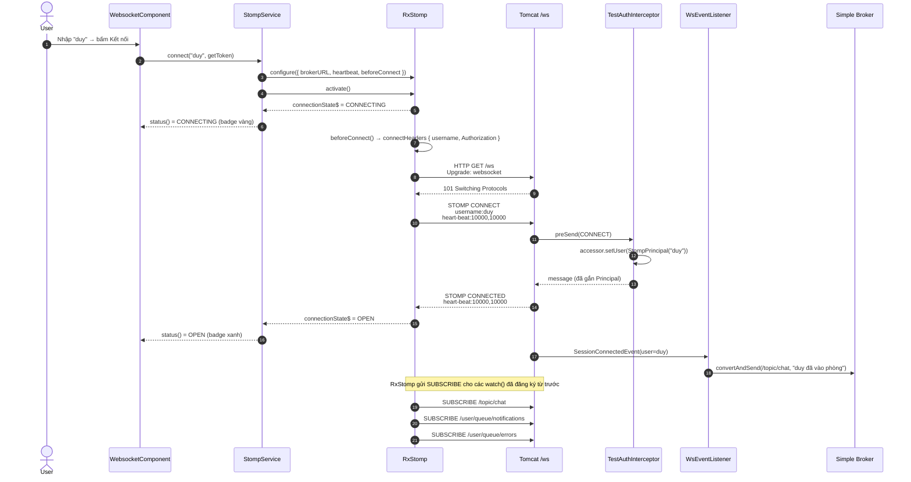
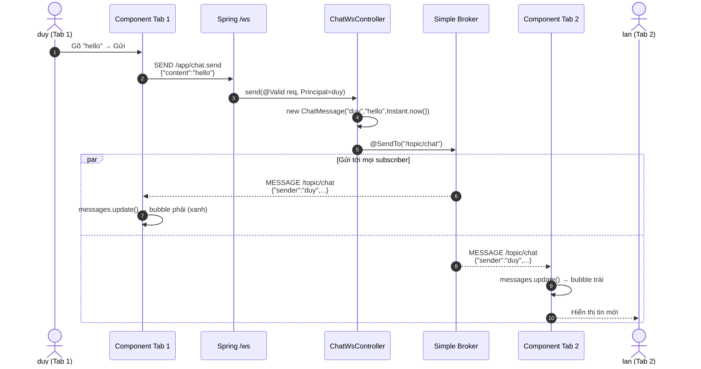
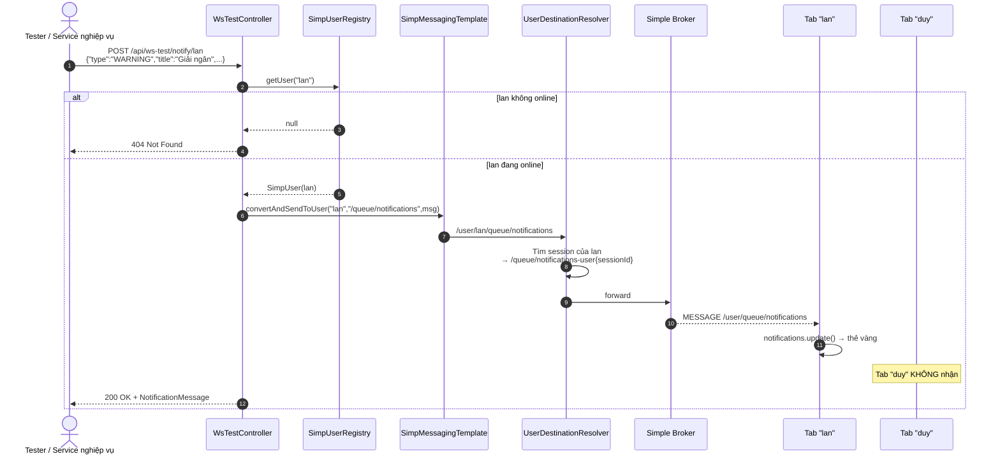
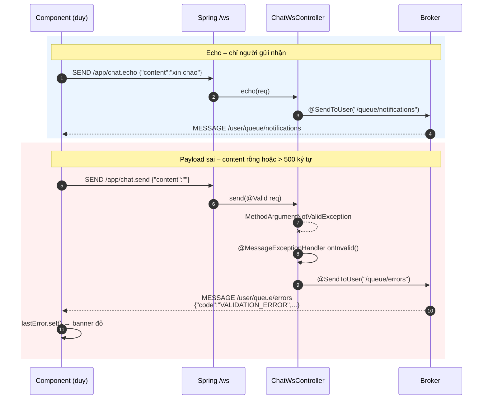
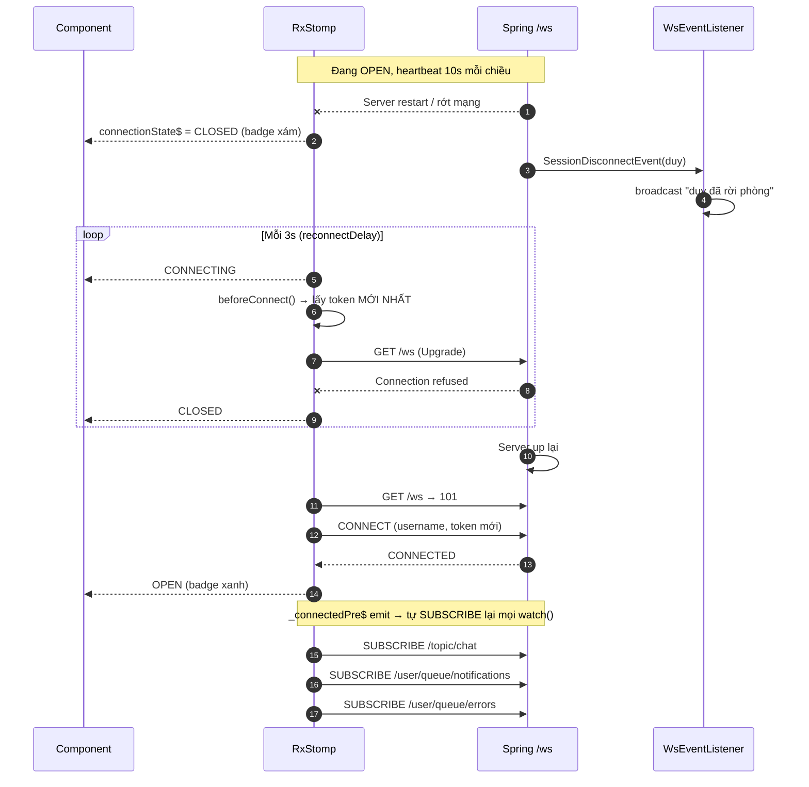
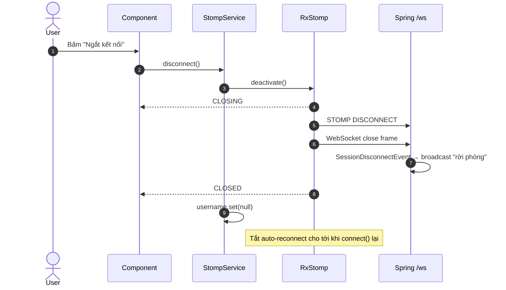
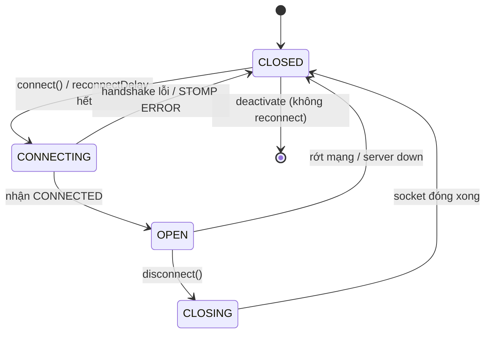
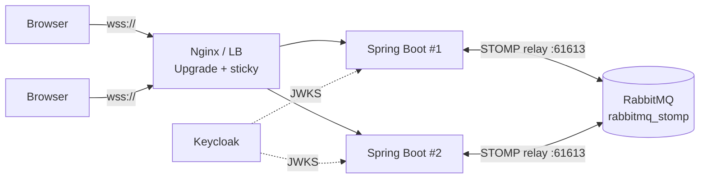

# WebSocket Feature – Angular 22 × Spring Boot 4.1.2 (STOMP)

Tính năng nhắn tin realtime hai chiều giữa Angular và Spring Boot, dùng giao thức **STOMP over WebSocket**:

- **Chat broadcast**: một người gửi, tất cả client đang mở trang đều nhận.
- **Thông báo riêng**: server đẩy tin cho đúng một user (ví dụ: hồ sơ giải ngân chờ duyệt).
- **Echo / lỗi riêng**: phản hồi chỉ gửi về cho người vừa gửi.
- **Tự reconnect**: rớt mạng thì tự kết nối lại, tự subscribe lại và lấy token mới.

---

## 1. Tech stack

| Tầng | Công nghệ |
|---|---|
| Frontend | Angular 22 (standalone, signals, OnPush), `@stomp/rx-stomp` |
| Backend | Spring Boot 4.1.2, Spring Framework 7, `spring-boot-starter-websocket`, Jackson 3 |
| Server | Tomcat 11 (embedded) |
| Broker | Spring Simple Broker (in-memory); production thì dùng RabbitMQ STOMP relay |
| Giao thức | WebSocket (RFC 6455) + STOMP 1.2 |

---

## 2. Kiến trúc tổng quan



### Quy ước destination

| Hướng | Destination | Xử lý bởi | Payload |
|---|---|---|---|
| Client → Server | `/app/chat.send` | `ChatWsController#send` | `{ "content": "hello" }` |
| Client → Server | `/app/chat.echo` | `ChatWsController#echo` | `{ "content": "abc" }` |
| Server → Tất cả | `/topic/chat` | Simple Broker | `ChatMessage` |
| Server → 1 user | `/user/queue/notifications` | UserDestinationResolver | `NotificationMessage` |
| Server → 1 user | `/user/queue/errors` | `@MessageExceptionHandler` | `ErrorMessage` |

> Prefix `/app` dành cho message đi vào `@MessageMapping`. Prefix `/topic` và `/queue` đi thẳng vào broker. Prefix `/user` được Spring đổi thành queue riêng theo session, ví dụ `/queue/notifications-user{sessionId}`.

---

## 3. Cấu trúc thư mục

### Frontend

```
src/
├── environments/environment.ts          # wsUrl: 'ws://localhost:8080/ws'
└── app/
    ├── core/
    │   ├── models/ws-message.ts         # ChatMessage, NotificationMessage, WsError, WsStatus
    │   └── services/stomp.service.ts    # Bọc RxStomp: connect/disconnect/watch/publish
    └── features/
        └── websocket/
            ├── websocket.component.ts   # State bằng signal, subscribe 3 kênh
            ├── websocket.component.html # Chat + Thông báo + Kết nối
            └── websocket.component.scss
```

### Backend

```
com.example.websocket/
├── config/
│   ├── WebSocketConfig.java       # Endpoint /ws, broker, heartbeat, interceptor
│   ├── TestAuthInterceptor.java   # CONNECT: header username → Principal
│   └── WsEventListener.java       # Log + broadcast vào/rời phòng
├── controller/
│   ├── ChatWsController.java      # @MessageMapping chat.send / chat.echo
│   └── WsTestController.java      # REST: online, notify, broadcast
└── dto/WsDtos.java                # Record: request/response/principal
```

---

## 4. Sequence flows

### 4.1. Kết nối (Handshake + STOMP CONNECT)



### 4.2. Chat broadcast (`/app/chat.send` → `/topic/chat`)



### 4.3. Thông báo riêng từ server (REST → `/user/queue/notifications`)

Đây là luồng dùng cho nghiệp vụ, ví dụ khi duyệt xong hồ sơ thì báo cho người tạo.



### 4.4. Echo và lỗi validation (`@SendToUser`)



### 4.5. Mất kết nối và tự reconnect



### 4.6. Ngắt kết nối chủ động



### 4.7. Vòng đời trạng thái kết nối



---

## 5. Cài đặt và chạy

### Backend

```groovy
// build.gradle
dependencies {
    implementation 'org.springframework.boot:spring-boot-starter-web'
    implementation 'org.springframework.boot:spring-boot-starter-websocket'
    implementation 'org.springframework.boot:spring-boot-starter-validation'
    compileOnly 'org.projectlombok:lombok'
    annotationProcessor 'org.projectlombok:lombok'
}
```

```bash
./gradlew clean bootRun        # http://localhost:8080
```

### Frontend

```bash
npm i @stomp/rx-stomp
ng serve                       # http://localhost:4200/websocket
```

---

## 6. Kịch bản test

| # | Thao tác | Kết quả mong đợi |
|---|---|---|
| 1 | Tab 1 kết nối với tên `duy` | Badge **OPEN**, hiện "duy đã vào phòng" |
| 2 | Tab 2 kết nối với tên `lan` | Cả 2 tab thấy "lan đã vào phòng" |
| 3 | Tab 1 gõ `hello` | Tab 1 thấy bubble phải, tab 2 thấy bubble trái |
| 4 | Tab 1 gõ `/echo xin chào` | Chỉ tab 1 nhận trong khung Thông báo |
| 5 | Gửi tin rỗng qua devtools | Banner đỏ `VALIDATION_ERROR` |
| 6 | `curl` notify `lan` | Chỉ tab 2 nhận thẻ vàng |
| 7 | Tắt BE rồi bật lại | Badge CLOSED → CONNECTING → OPEN, tự nhận tin lại |
| 8 | Tab 2 bấm Ngắt kết nối | Tab 1 thấy "lan đã rời phòng" |

```bash
# User đang online
curl http://localhost:8080/api/ws-test/online
# ["duy","lan"]

# Thông báo riêng
curl -X POST http://localhost:8080/api/ws-test/notify/lan \
  -H 'Content-Type: application/json' \
  -d '{"type":"WARNING","title":"Giải ngân","body":"Hồ sơ #FX-1023 chờ duyệt"}'

# Broadcast từ server
curl -X POST "http://localhost:8080/api/ws-test/broadcast?content=B%E1%BA%A3o%20tr%C3%AC%2023h"
```

---

## 7. Troubleshooting

| Triệu chứng | Nguyên nhân | Cách sửa |
|---|---|---|
| `Invalid character found in method name [0x160x030x01...]` | Client gửi TLS (`wss://`, `https://`) vào port HTTP | Đổi thành `ws://localhost:8080/ws` và `http://` |
| `variable xxx not initialized in the default constructor` | Lombok không chạy | Thêm `annotationProcessor`, nâng Lombok, bật annotation processing trong IDE |
| Badge kẹt ở CONNECTING, console báo 403 | CORS origin không khớp | `setAllowedOriginPatterns("http://localhost:4200")` |
| Badge kẹt ở CONNECTING, console báo 401/403 (có Security) | `/ws/**` bị Spring Security chặn | `requestMatchers("/ws/**").permitAll()` |
| Gửi chat thì BE báo NPE ở `principal.getName()` | Interceptor chưa gắn Principal | Kiểm tra đã đăng ký `configureClientInboundChannel` |
| Không nhận được `/user/queue/...` | Không có Principal, hoặc gửi sai username | `GET /api/ws-test/online` để xem đúng tên |
| Trang `https://` không kết nối được `ws://` | Trình duyệt chặn mixed content | Dùng proxy Angular (`"ws": true`) hoặc bật SSL cho BE |

---

## 8. Hướng lên production



| Hạng mục | Dev (hiện tại) | Production |
|---|---|---|
| Xác thực | `TestAuthInterceptor` (header `username`) | `JwtChannelInterceptor` dùng `JwtDecoder` (Keycloak), lấy `preferred_username` |
| Broker | `enableSimpleBroker` (in-memory) | `enableStompBrokerRelay` → RabbitMQ, để các instance nhìn thấy message của nhau |
| Transport | `ws://` | `wss://`, kết thúc TLS ở Nginx |
| Nginx | — | `proxy_set_header Upgrade $http_upgrade; Connection "upgrade"; proxy_read_timeout 60s` |
| Token hết hạn | Token cố định | `beforeConnect` refresh token trước mỗi lần reconnect |
| Gửi khi offline | `retryIfDisconnected: false` | Giữ `false` cho lệnh nghiệp vụ; với lệnh quan trọng thì dùng `receipt` + `asyncReceipt()` |
| Endpoint test | `/api/ws-test/**` | Xóa, hoặc giới hạn bằng `@Profile("dev")` |
