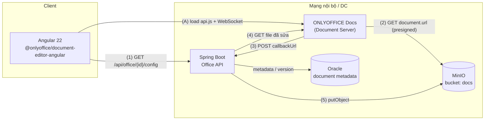
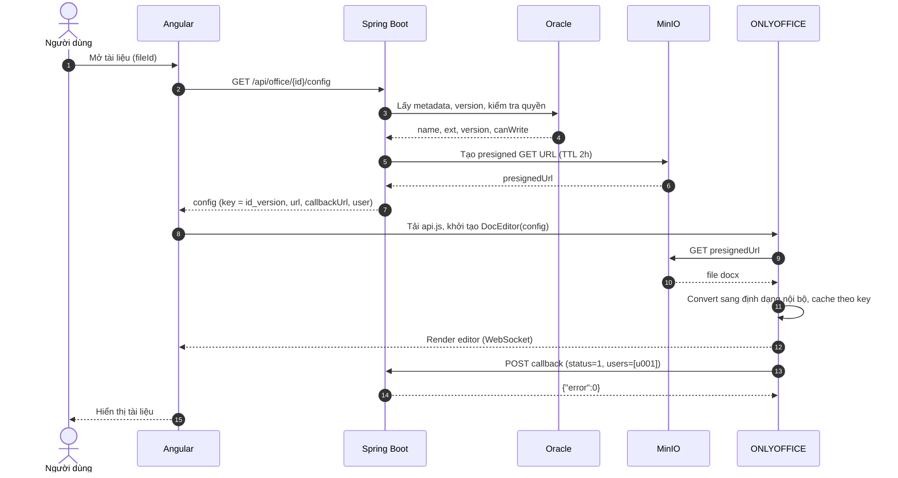
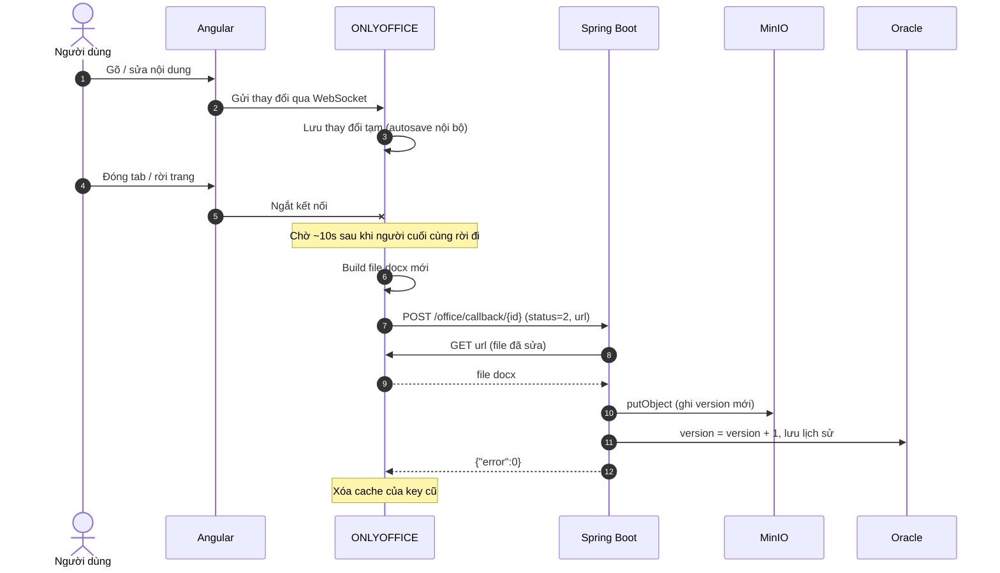
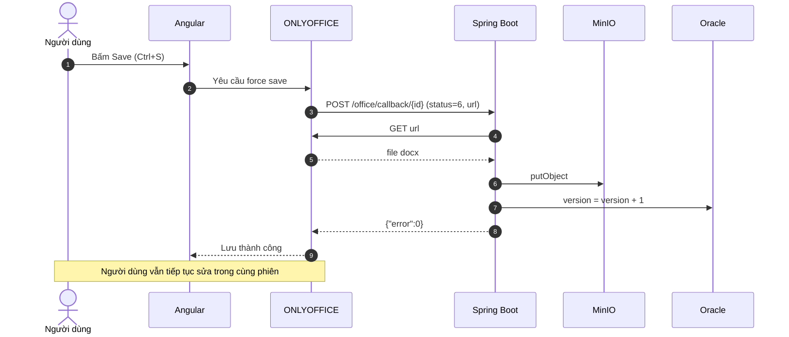
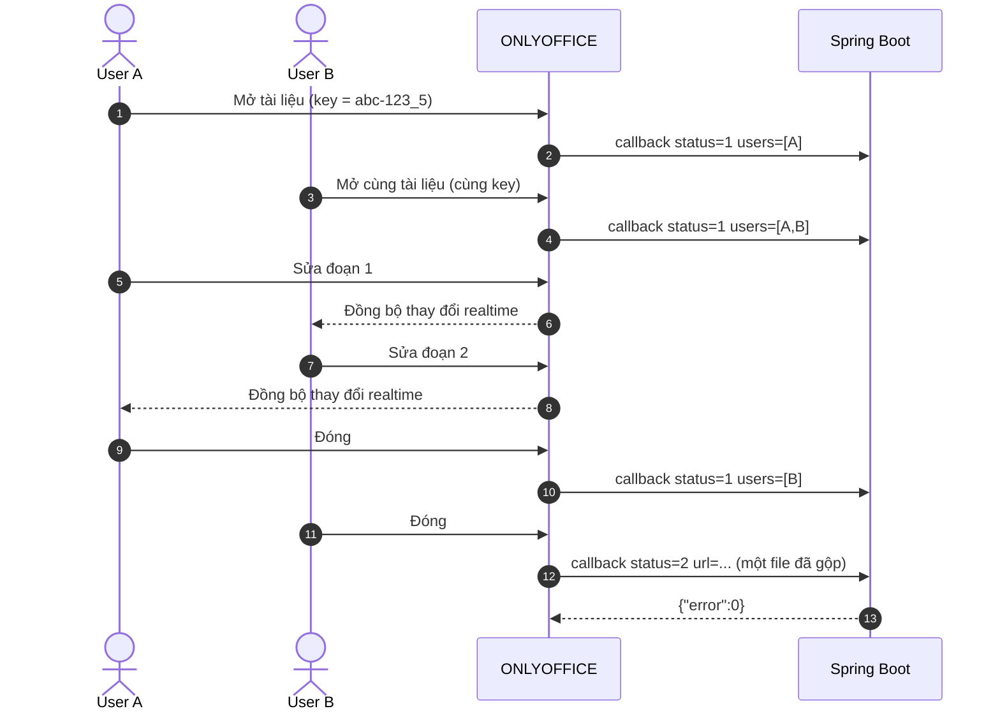

# Tích hợp ONLYOFFICE Docs vào Angular + Spring Boot

Tài liệu mô tả kiến trúc nhúng trình soạn thảo văn bản (docx/xlsx/pptx) vào ứng dụng Angular 22, sử dụng **ONLYOFFICE Docs Community Edition** (tự host, AGPL-3.0), backend **Spring Boot**, lưu trữ file trên **MinIO**, metadata trên **Oracle**.

---

## 1. Tổng quan kiến trúc



**Nguyên tắc:** ONLYOFFICE **không lưu trữ file**. Nó chỉ là bộ soạn thảo:
- **Lấy file** từ `document.url` (presigned URL của MinIO).
- **Trả file** sau khi sửa bằng cách gọi `callbackUrl` trên Spring Boot.

Browser **nói chuyện trực tiếp** với ONLYOFFICE để soạn thảo (WebSocket). Còn các bước tải/lưu file là **server-to-server** giữa ONLYOFFICE và backend, browser không tham gia.

---

## 2. Thành phần

| Thành phần | Công nghệ | Trách nhiệm |
|---|---|---|
| **Frontend** | Angular 22, `@onlyoffice/document-editor-angular` | Lấy config từ backend, render editor, xử lý event (`onDocumentReady`, lỗi load) |
| **Office API** | Spring Boot | Cấp config editor (phân quyền, `document.key`, presigned URL); nhận callback, lưu file mới, tăng version |
| **ONLYOFFICE Docs** | Docker `onlyoffice/documentserver` | Render và soạn thảo tài liệu, đồng bộ cộng tác realtime, convert định dạng, gọi callback khi lưu |
| **MinIO** | Object storage | Lưu file gốc và các version |
| **Oracle** | RDBMS | Metadata: tên file, owner, version hiện tại, lịch sử chỉnh sửa |

---

## 3. API backend

| Method | Endpoint | Gọi bởi | Mô tả |
|---|---|---|---|
| `GET` | `/api/office/{id}/config` | Angular (có xác thực người dùng) | Trả config editor |
| `POST` | `/office/callback/{id}` | ONLYOFFICE | Nhận trạng thái; status `2`/`6` → tải file mới, lưu MinIO, tăng version; luôn trả `{"error":0}` |

### Ví dụ config trả về FE

```json
{
  "documentType": "word",
  "document": {
    "fileType": "docx",
    "key": "abc-123_5",
    "title": "phieu-giai-ngan.docx",
    "url": "https://minio.internal/docs/abc-123.docx?X-Amz-Signature=...",
    "permissions": { "edit": true, "download": true }
  },
  "editorConfig": {
    "callbackUrl": "http://office-api.internal:8080/office/callback/abc-123",
    "lang": "vi",
    "user": { "id": "u001", "name": "Nguyễn Văn A" },
    "customization": { "forcesave": true }
  }
}
```

> **`document.key`** = `{fileId}_{version}`. Bắt buộc **đổi key sau mỗi lần lưu**, nếu không ONLYOFFICE dùng bản cache cũ. Ký tự hợp lệ: `0-9 a-z A-Z . = _ -`, tối đa 128 ký tự.

### Bảng status callback

| Status | Ý nghĩa | Backend xử lý |
|---|---|---|
| `1` | Đang được chỉnh sửa | Bỏ qua |
| `2` | Tất cả người dùng đã đóng, có thay đổi | **Tải `url`, lưu, tăng version** |
| `3` | Lỗi khi lưu | Log, cảnh báo |
| `4` | Đóng, không có thay đổi | Bỏ qua |
| `6` | Force save (người dùng bấm Save) | **Tải `url`, lưu, tăng version** |
| `7` | Lỗi force save | Log, cảnh báo |

---

## 4. Sequence diagram

### 4.1 Mở tài liệu



### 4.2 Chỉnh sửa và lưu khi đóng (status 2)



### 4.3 Force save (người dùng bấm Save, status 6)



### 4.4 Nhiều người cùng chỉnh sửa



> Các user cùng sửa **phải nhận cùng `document.key`**, ONLYOFFICE dựa vào key để gộp vào một phiên chung.

---

## 5. Triển khai

### Docker Compose (ONLYOFFICE)

```yaml
services:
  onlyoffice:
    image: onlyoffice/documentserver:8.3   # pin version, không dùng latest ở production
    ports: ["8081:80"]
    environment:
      - JWT_ENABLED=false                  # xem mục 6
      - ALLOW_PRIVATE_IP_ADDRESS=true      # cho phép gọi MinIO/backend ở IP nội bộ
    volumes:
      - oo_data:/var/www/onlyoffice/Data
      - oo_lib:/var/lib/onlyoffice
      - oo_db:/var/lib/postgresql
      - ./fonts:/usr/share/fonts/truetype/custom
volumes: { oo_data: {}, oo_lib: {}, oo_db: {} }
```

Sau khi thêm font tiếng Việt:

```bash
docker exec onlyoffice /usr/bin/documentserver-generate-allfonts.sh
curl http://localhost:8081/healthcheck   # trả về true
```

### Yêu cầu kết nối mạng

| Từ | Đến | Mục đích |
|---|---|---|
| Browser | ONLYOFFICE `:8081` | Tải `api.js`, WebSocket soạn thảo |
| Browser | Spring Boot | Lấy config |
| ONLYOFFICE | MinIO | Tải file gốc (presigned URL) |
| ONLYOFFICE | Spring Boot | Gọi callback |
| Spring Boot | ONLYOFFICE | Tải file đã sửa (`url` trong callback) |

> `callbackUrl` và `document.url` phải là địa chỉ **container ONLYOFFICE truy cập được**. Không dùng `localhost`.

---

## 6. Bảo mật

### Chế độ hiện tại: tắt JWT (`JWT_ENABLED=false`), chỉ dùng cho dev/POC

Các biện pháp bù đắp bắt buộc:

1. **Giới hạn IP:** chỉ IP/subnet của ONLYOFFICE được gọi `/office/callback/**`.
2. **Chống SSRF:** trong callback, chỉ tải file khi `url` có host đúng là ONLYOFFICE.
3. **Presigned URL ngắn hạn:** `document.url` hết hạn sau 2h, không public bucket.
4. **Không expose cổng ONLYOFFICE ra Internet:** chỉ đi qua reverse proxy nội bộ (TLS, mở WebSocket).

### Khuyến nghị UAT/Production: bật JWT

- `JWT_ENABLED=true`, `JWT_SECRET` ≥ 32 ký tự, dùng chung giữa ONLYOFFICE và backend.
- Backend ký toàn bộ config (HS256), gắn vào trường `token`.
- Backend verify `token` trong body callback, chỉ tin dữ liệu trong claims đã ký.
- Thư viện: tái sử dụng **Nimbus JOSE + JWT** (có sẵn nếu dùng Spring Security OAuth2), hoặc `jjwt`.

---

## 7. Giới hạn và lưu ý

- **Community Edition giới hạn 20 kết nối đồng thời.** Người dùng thứ 21 chỉ được mở ở chế độ xem. Cần theo dõi số người dùng trước khi mở rộng phạm vi.
- **License AGPL-3.0:** dùng nguyên bản thì không phát sinh nghĩa vụ. Nếu sửa source ONLYOFFICE thì phải cung cấp source đã sửa cho người dùng. Ứng dụng Angular/Spring Boot gọi qua API không bị ảnh hưởng.
- **Lưu khi đóng có độ trễ khoảng 10 giây** sau khi người cuối cùng rời đi. Muốn lưu ngay thì dùng force save (`customization.forcesave: true`).
- **Idempotency:** callback có thể bị gửi lại. Backend nên kiểm tra `key`/version để tránh tăng version hai lần.

### Lỗi thường gặp

| Lỗi | Nguyên nhân | Cách xử lý |
|---|---|---|
| *Download failed* | ONLYOFFICE không gọi được `document.url` | Kiểm tra mạng, `ALLOW_PRIVATE_IP_ADDRESS`, presigned URL hết hạn |
| *Document security token is not correctly formed* | JWT đang bật ở server nhưng config không có `token` | Tắt JWT hoặc ký config |
| Mở ra bản cũ | `document.key` không đổi sau khi lưu | Key gắn với version |
| Không lưu được | Callback không trả `{"error":0}` hoặc không gọi được callback | Kiểm tra log ONLYOFFICE, firewall |